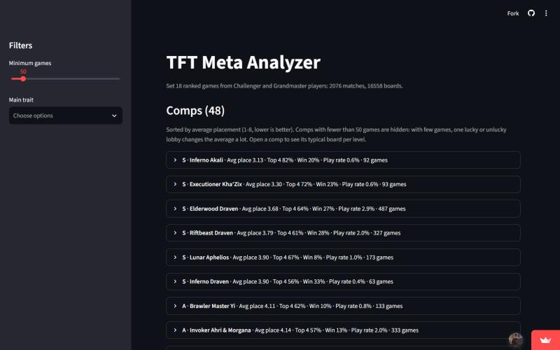
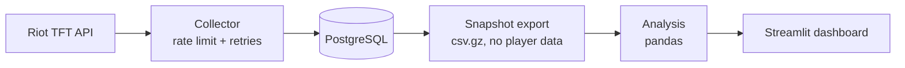
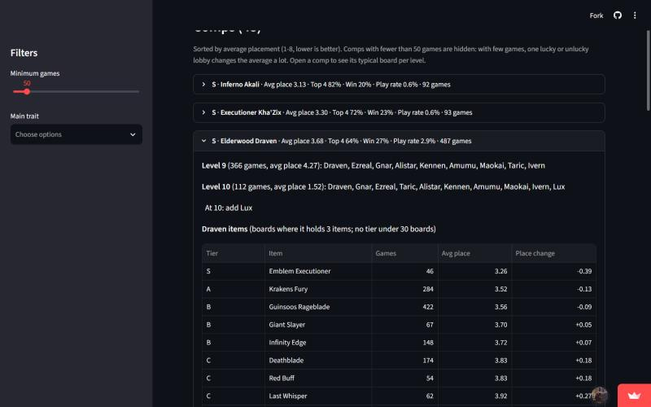

# TFT Meta Analyzer

**Live dashboard: https://tft-meta-analyzer.streamlit.app/**

A data pipeline that collects top-ranked Teamfight Tactics games from the Riot Games API, stores them in PostgreSQL, groups thousands of player boards into strategies with pandas, and shows which strategies and items perform best in a Streamlit dashboard.



## The game in two sentences

Teamfight Tactics (TFT) is an online strategy game where 8 players each build a team of units on a board, and the teams fight automatically until one player is left; every game ends with a placement from 1st (best) to 8th. Units belong to shared groups called *traits*, and players give them *items*, so a winning team ("comp") is a combination of units, traits and items.

## The problem, without the game

Each finished game gives 8 records. Every record is an outcome (a placement from 1 to 8) together with a set of components (units, their star levels and items) and the groups those components activate (traits). The questions are:

- **Grouping:** how do you turn thousands of slightly different component sets into a small number of meaningful categories, when no category label exists in the data?
- **Comparison:** which categories lead to better outcomes, and how much can a result be trusted when some categories have only a few dozen records?
- **Attribution:** inside a category, which optional choices (items) go together with better outcomes, and how do you compare them fairly?

These are general questions for any data set of "configurations plus an outcome", whether the records are games, products or flights.

## How it works



1. **Collector** (`src/tft_meta/collector`). It reads the Challenger and Grandmaster ladders, then each player's recent match ids, then the match details. A sliding-window rate limiter keeps requests under the API key limits (20 per second, 100 per 2 minutes). Rate-limit responses (429) wait for the time the server asks for; temporary server errors (5xx) are retried with exponential backoff. Matches already in the database are skipped.
2. **Storage** (`src/tft_meta/storage`). PostgreSQL with five tables: matches, participants, units, traits and items, linked by foreign keys and indexed on the join columns. Each match is saved in one transaction, so a failed match leaves no half-written rows. Player names and ids are never stored.
3. **Snapshot** (`storage/snapshot.py`). The four tables the analysis needs are exported to compressed CSV files (about 2 MB) so the dashboard runs without a database. Riot match ids are replaced by plain numbers, because a match id leads back to the players of that match.
4. **Analysis** (`src/tft_meta/analysis`). Groups boards into comps, computes comp statistics and tiers, typical boards per level and item statistics (details below).
5. **Dashboard** (`src/tft_meta/dashboard/app.py`). Streamlit page with filters (minimum games, main trait), one row per comp and a detail view per comp.

## Results

Data: **2,076 ranked games** (Set 18, Challenger and Grandmaster, Europe West), **16,608 player boards**.

- The 16,558 boards with an identifiable comp fall into 457 raw groups. Merging and the sample filter leave **48 comps with at least 50 games**, which together cover 13,926 boards (84%).
- **The most played comp is not the best one.** Riftbeast Brambleback is played on 11% of all boards with an average placement of 4.29, while the best comps average 3.1 to 3.9 but are played on only 0.4% to 3% of boards.
- **Tiers:** 6 comps are S tier (average placement below 4.0), 10 A, 21 B and 11 C. The weakest comp with enough games averages 7.3.
- **Level is a strong confounder.** Boards that reached level 8 average 4.95, level 9 averages 3.50 and level 10 averages 1.62. Players who are already winning live longer and level up, so a comparison that ignores this credits late-game units and items with wins they did not cause.



## Method

**Comp = main trait + carry.** The main trait is the active trait with the most units. The carry is the unit holding the most items, with three rules from game knowledge, stored as hand-marked columns in `reference/unit_roles_set18.csv` so they can change per game season without code changes:

- tanks and *side carries* (units that hold items but are not what the comp is built around) are never the carry;
- on a tie, the most expensive units go last, because they usually arrive only at the end of a game, except units marked as top-cost carries;
- then more stars, then higher cost.

**Merging similar groups.** Within the same main trait, groups with at least 20 games are merged into one comp when either:

- each group's carry is a *core unit* (on at least 50% of boards) of the other group, or
- their core units overlap by at least 80% (shared units divided by the size of the smaller core, so a comp that only adds a few units to another still matches).

Each group is compared only with the leader of an existing comp, so unrelated groups cannot be chained together through a middle group. A comp is named after its carries that carry at least 30% of its boards (at most two).

**Comp statistics and tiers.** Games, average placement, top 4 rate, win rate and play rate per comp. Comps with fewer than 50 games are hidden (adjustable in the dashboard), because one lucky or unlucky lobby moves a small average a lot. Tiers use fixed limits on average placement (S < 4.0, A < 4.4, B < 4.7, C otherwise), so a tier means the same thing in every patch.

**Typical board per level.** For each level, the most common units of the comp fill the level's board slots (one unit, Elder Dragon takes two). The difference between levels gives "at level 9, add these units".

**Item statistics.** For each named carry, every item's average placement is compared with a baseline: *place change = item's average placement − carry's average placement*. Negative is better. The baseline only uses boards where the carry holds a full set of three items. With all boards as the baseline, nearly every item looked good, because boards with fewer items mostly belong to players who were knocked out early. This change moved the median place change from −0.10 to −0.02. Items need 10 boards to be shown and 30 boards to get a tier (S < −0.30, A < −0.10, B < +0.10, C otherwise).

## Limitations

- **Correlation, not cause.** A good place change means the item went together with better results, not that the item caused them; players may build an item only when the game is already going well.
- **Survivorship.** Final boards are recorded at the end of each player's game, so late-game units and items appear more often on boards that survived longer.
- **Group definitions change averages.** In one test, moving 54 boards between two comps changed one comp's average placement from 3.23 to 2.80 without any change in how that comp actually performed. Every rule for defining a comp was therefore checked against game knowledge before it was kept.
- **Hand-labelled roles.** Unit roles come from the champion list on blitz.gg, because the game data for this season has no role field.
- **Coverage.** One region, top two ranks, the recent games of each player at collection time, and the Riot API does not report the patch version for these games.

## Tech stack

- **Python 3**, **requests** for the Riot API
- **PostgreSQL** with **psycopg 3** (parameterised queries, explicit transactions)
- **pandas** for grouping and statistics
- **Streamlit** for the dashboard, deployed on Streamlit Community Cloud
- **python-dotenv** for configuration; API keys live only in a local `.env` file that is never committed

## Run it yourself

The dashboard only needs the snapshot that is already in the repository:

```bash
python -m venv .venv
.venv\Scripts\python.exe -m pip install -r requirements.txt
.venv\Scripts\python.exe -m streamlit run src/tft_meta/dashboard/app.py
```

To collect new data you also need a PostgreSQL database and a Riot API key. Create a `.env` file in the project root with `RIOT_API_KEY` and `DATABASE_URL`, then:

```bash
$env:PYTHONPATH = "src"
.venv\Scripts\python.exe -m tft_meta.collector.pipeline --max-players 200 --matches-per-player 20
.venv\Scripts\python.exe -m tft_meta.storage.snapshot
```

The dashboard reloads its data when the snapshot files change. After changing code in `analysis/` or `storage/`, restart Streamlit (or "Reboot app" on Streamlit Cloud), because Streamlit only reloads the main script.

## How AI was used

I built this project together with Claude (Anthropic) as a pair programmer in Claude Code:

- **Where:** planning the folder structure and daily plan, explaining concepts I had not used before (rate limiting, transactions, pandas group operations), writing parts of the code with me, and writing tests in scratch scripts.
- **How I stayed in control:** I filled in the key lines myself (for example the parser fields and the place change formula), and every analysis rule was checked against my own knowledge of the game. Several AI suggestions were rejected after I looked at the results: picking the cheapest unit as carry, ignoring emblems when counting items, and treating every emblem holder as the carry. Each of these produced comp names that a player would immediately see as wrong.
- **How output was checked:** every rule was first tested on the real data in a separate script, comparing the comp names, counts and averages before and after, and only then moved into the code. The Riot queue id for ranked games was checked against Riot's official queue list rather than taken from memory.

## What I learned

- Building a collector that respects API rate limits and recovers from errors, instead of a single loop of requests.
- Designing a relational schema with foreign keys, indexes and transactions, and keeping personal data out of it.
- That grouping is the hardest part of the analysis: a definition that looks reasonable in code can still be wrong for the domain, and it changes every number built on top of it.
- Thinking about fair comparisons: sample size limits, the right baseline, and confounders such as player level and survivorship.
- Separating data collection, analysis and presentation into modules, so the same analysis code works with a database, with exported files, and later with a web API.
